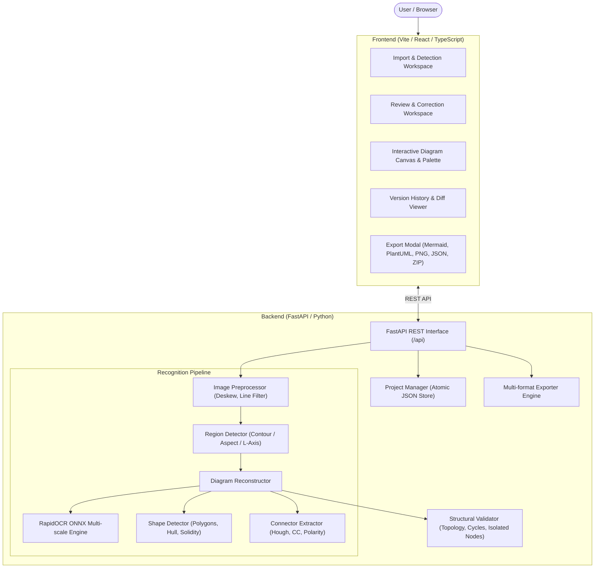

# Optical Diagram Recognition (ODR)

*Recognize, reconstruct, edit, and export flowcharts, technical diagrams, and charts from images.*

[](LICENSE)
[](https://www.python.org/downloads/)
[](https://nodejs.org/)
[](https://github.com/v3ravani/Optical-Diagram-Recognition-ODR-/stargazers)
[](https://github.com/v3ravani/Optical-Diagram-Recognition-ODR-/network/members)
[](https://github.com/v3ravani/Optical-Diagram-Recognition-ODR-/issues)

---

## Overview

Optical Diagram Recognition (ODR) is an open-source software system that transforms static diagram images into structured, editable, and machine-readable models. It parses visual inputs from scanned documents, whiteboard photos, digital technical diagrams, and desktop screenshots, extracting the underlying semantic entities, connections, and data series.

In engineering, architecture, and business documentation, critical systems diagrams frequently remain trapped in raster image formats, PDFs, or slides. Modifying, maintaining, or converting these static visuals into documentation code normally requires manual redrawing from scratch. ODR bridges this gap by automatically recovering diagram structure directly from raw pixel data.

Recognizing technical diagrams requires significantly more than standard optical character recognition. Traditional OCR systems assume linear, unidirectional text organized into horizontal lines and paragraphs. Technical diagrams, in contrast, are non-linear two-dimensional visual graphs. Text labels perform varied roles as node headers, nested step instructions, or conditional decision branch tags (`Yes`/`No`/`True`/`False`). Crucially, the meaning of a diagram depends on its spatial and geometric relationships: which shapes represent operations, where connectors begin and terminate, which direction arrowheads point, and how return loops feed back into preceding stages.

ODR addresses these challenges through a modular computer vision and geometric reconstruction engine:

- **Shape and Text Recognition**: Identifies geometric contours (process steps, decision diamonds, terminals, input/output blocks, and database stores), isolates text blocks, and associates each label with its corresponding enclosing node.
- **Topological Connector Tracing**: Traces connecting lines, evaluates arrow polarity, prunes spurious bypass lines across intermediate steps, deduplicates overlapping stroke fragments, and binds decision branch conditions.
- **Structural Validation & Verification**: Inspects topological integrity (such as detecting isolated nodes or single-branch decisions) and provides a synchronized review workspace where selecting any diagram node highlights its original crop on the source image.
- **Visual Editing & Multi-Format Export**: Includes an interactive browser canvas for port connection, manual arrow drawing, and styling, with native export to Mermaid (`.mmd`), PlantUML (`.puml`), canonical JSON (`.json`), high-resolution PNG (`.png`), and complete ZIP distribution archives.

The engine supports flowcharts, sequence diagrams, data flow diagrams (DFD), entity-relationship diagrams (ERD), bar charts, and pie charts.

---

## Table of Contents

- [Overview](#overview)
- [Features](#features)
- [Supported Diagram Types](#supported-diagram-types)
- [Demonstrations and Visuals](#demonstrations-and-visuals)
- [Architecture](#architecture)
- [Technology Stack](#technology-stack)
- [Prerequisites](#prerequisites)
- [Installation](#installation)
  - [Backend Setup](#backend-setup)
  - [Frontend Setup](#frontend-setup)
- [Configuration](#configuration)
- [Running ODR](#running-odr)
  - [Starting the Backend Server](#starting-the-backend-server)
  - [Starting the Frontend Client](#starting-the-frontend-client)
- [How to Use](#how-to-use)
  - [1. Import and Automatic Detection](#1-import-and-automatic-detection)
  - [2. Multi-Diagram Selection and Manual Crop](#2-multi-diagram-selection-and-manual-crop)
  - [3. Recognition Review and Correction](#3-recognition-review-and-correction)
  - [4. Visual Canvas Editing](#4-visual-canvas-editing)
  - [5. Exporting and Saving](#5-exporting-and-saving)
- [Export Formats](#export-formats)
- [Project Structure](#project-structure)
- [Testing](#testing)
- [Troubleshooting](#troubleshooting)
- [Limitations](#limitations)
- [Roadmap](#roadmap)
- [Contributing](#contributing)
- [Security](#security)
- [License](#license)
- [Acknowledgements and References](#acknowledgements-and-references)

---

## Features

- **Local-First and Offline Privacy**: Runs entirely on the host machine. Images, diagrams, and project histories never leave the local environment.
- **Hand-Drawn and Printed Processing**: Accommodates high-contrast digital diagrams, scanned technical reports, multi-page PDFs, and hand-drawn whiteboard sketches.
- **Automatic Multi-Diagram Detection**: Identifies and separates multiple candidate diagrams located on a single page or document scan.
- **Interactive Manual Cropping**: Allows drawing custom bounding boxes directly on source pages to target specific sub-regions.
- **Synchronized Review Workspace**: Side-by-side inspection displaying the source image crop against the recognized diagram, with synchronized element highlighting.
- **Topological Connector Tracing**: Traces orthogonal and diagonal connectors, resolves directional arrow polarity, prevents bypass false bridges, and pairs decision branches with conditional labels.
- **Interactive Visual Editor**: Full-featured SVG canvas supporting node movement, resizing, port connection, manual arrow drawing, undirected lines, curved and orthogonal routing, and undo/redo stacks.
- **Project Persistence and Version History**: Automatic debounced persistence with atomic file writes and milestone checkpoints.
- **Multi-Format Serialization**: Native export to Mermaid code, PlantUML syntax, canonical JSON schemas, high-resolution PNG images, and complete ZIP distribution bundles.

---

## Supported Diagram Types

The following table summarizes the implementation and maturity level for each diagram notation in ODR:

| Diagram Family | Implementation Status | Supported Features | Current Limitations |
|---|---|---|---|
| Flowcharts | Production | Start/End terminals, process boxes, decision diamonds, IO parallelograms, databases, predefined subroutines, document shapes, directed/undirected connectors, loops, branch labels (`Yes`/`No`/`True`/`False`). | Highly overlapping curved lines in low-contrast scans may require manual port adjustment in the editor. |
| Bar Charts | Production | Automatic coordinate axis detection, vertical bar extraction, baseline alignment, category assignment, value estimation, and Mermaid `xychart-beta` export. | Horizontal stacked bar charts and dual-axis charts are currently parsed as single series. |
| Pie Charts | Production | Circular disc detection, radial spoke extraction, slice percentage calculation, label association, and Mermaid `pie` export. | Doughnut charts and 3D exploded charts are approximated as standard 2D pies. |
| Data Flow Diagrams (DFD) | Supported | External entities, processes, data stores, and labeled directional data flows. | Gane-Sarson open-ended rectangle notation is parsed into canonical data store elements. |
| Sequence Diagrams | Supported | Participant lifelines across horizontal headers, chronological message arrows, and return messages. | Activation boxes (focus of control) are parsed as lifelines. |
| Entity-Relationship (ERD) | Supported | Entities, key attributes, regular attributes, and relationship diamonds. | Crow's foot cardinality markers are parsed as directed or undirected links. |

---

## Demonstrations and Visuals

Sample diagrams recognized and benchmarked by the ODR test suite are maintained in the `docs/assets/` directory:

- **Order Processing Flowchart**: `docs/assets/flowchart_order.png` (Standard multi-step decision flowchart).
- **Lamp Troubleshooting Diagram**: `docs/assets/hand_drawn_lamp.png` (Hand-drawn maintenance decision tree).
- **Quarterly Bar Chart**: `docs/assets/barchart_quarterly.png` (Coordinate-axis numerical bar chart).
- **Multi-Diagram Document Page**: `docs/assets/multi_diagram_page.png` (Document page containing multiple diagram figures).

---

## Architecture

The system is partitioned into a modular backend processing pipeline and an interactive frontend visual editor:



For detailed architectural specifications, coordinate mapping formulas, and state lifecycle transitions, see [docs/architecture.md](docs/architecture.md).

---

## Technology Stack

### Backend
- **Framework**: FastAPI (Python 3.10+) with Uvicorn ASGI runtime.
- **Computer Vision**: OpenCV (`opencv-python`) and NumPy for contour analysis, Hough line transforms, and morphology.
- **OCR Engine**: RapidOCR ONNX Runtime (`rapidocr-onnxruntime`) executing PP-OCRv4 models locally via CPU.
- **Document Ingestion**: PyMuPDF (`pymupdf`) for rendering vector and scanned PDF documents into raster arrays.
- **Image Generation**: Pillow (`PIL`) for standalone high-resolution antialiased raster rendering.
- **Testing**: Pytest (`pytest`, `pytest-asyncio`, `httpx`).

### Frontend
- **Framework**: React 19 with TypeScript.
- **Build Tool**: Vite.
- **Styling**: Vanilla CSS with customized technical design tokens.
- **Icons**: Lucide React.
- **HTTP Client**: Standard native Fetch API with type-safe service wrappers.

---

## Prerequisites

Before installing ODR, verify that the following runtimes are installed on your host machine:

- **Python**: Version 3.10 or newer (tested on 3.10, 3.11, 3.12, 3.13, and 3.14).
- **Node.js**: Version 18.0 or newer (tested on Node 20 LTS and Node 24).
- **npm**: Version 9.0 or newer.
- **Hardware**: Any modern 64-bit x86 or ARM CPU with at least 4 GB RAM. Dedicated GPUs are not required; all models run efficiently on CPU.

---

## Installation

### Backend Setup

1. Create a Python virtual environment:
   ```bash
   python -m venv venv
   ```
2. Activate the virtual environment:
   - **Windows (PowerShell)**:
     ```powershell
     .\venv\Scripts\Activate.ps1
     ```
   - **Linux / macOS**:
     ```bash
     source venv/bin/activate
     ```
3. Install dependencies:
   ```bash
   pip install --upgrade pip
   pip install -r backend/requirements-dev.txt
   ```

### Frontend Setup

1. Navigate to the `frontend/` directory:
   ```bash
   cd frontend
   ```
2. Install npm dependencies:
   ```bash
   npm install
   ```
3. Return to project root:
   ```bash
   cd ..
   ```

---

## Configuration

ODR runs out of the box with default localhost settings. Optional configuration can be supplied through environment variables or a local `.env` file based on `.env.example`:

| Variable | Default Value | Description |
|---|---|---|
| `ODR_HOST` | `127.0.0.1` | Network interface for the backend server to bind. |
| `ODR_PORT` | `8000` | Port number for the backend FastAPI application. |
| `ODR_DATA_DIR` | `data` | Directory where projects, exports, and checkpoints are stored. |
| `ODR_CORS_ORIGINS` | `*` | Allowed CORS origins for browser client communication. |

---

## Running ODR

Running ODR requires starting both the backend API server and the frontend client.

### Starting the Backend Server

From the repository root:

```bash
python run_odr.py
```

The backend server will initialize:
- **API Base URL**: `http://127.0.0.1:8000`
- **Interactive Documentation**: `http://127.0.0.1:8000/docs`

### Starting the Frontend Client

In a separate terminal window:

```bash
cd frontend
npm run dev
```

The frontend client will be available at `http://localhost:5173/`. Vite automatically proxies requests from `/api` to the backend on `http://127.0.0.1:8000`.

---

## How to Use

The standard user workflow consists of five stages:

### 1. Import and Automatic Detection
Click **Import Document** in the navigation header. Upload an image file or PDF document. The system deskews the image and outlines detected candidate diagrams with bounding boxes.

### 2. Multi-Diagram Selection and Manual Crop
Review the detected candidate boxes. You may select one or more candidate regions, or use the interactive **Draw Crop** tool to draw a custom rectangle over a specific diagram figure.

### 3. Recognition Review and Correction
Click **Recognize & Edit**. ODR runs OCR, classifies shapes, traces connectors, and presents the **Review Workspace**:
- The source image crop is displayed on the left, and the recognized diagram is displayed on the right.
- Selecting any node highlights its corresponding bounding box on the original source image.
- The validation panel flags structural issues (e.g. single-branch decision diamonds or low-confidence characters) with recommendations for correction.

### 4. Visual Canvas Editing
Click **Continue to Editor** to open the interactive canvas:
- **Add Elements**: Drag shapes from the component palette (Process, Decision, Terminal, IO, Database, Cloud, Queue, Hexagon, Circle, Text).
- **Connect Elements**: Hover over port handles and drag connector lines between shapes.
- **Manual Arrow Drawing**: Click **Add Arrow** in the toolbar to enter direct line drawing mode between any two points.
- **Configure Connectors**: Select any connector to adjust its directionality (Directed, Undirected, Bidirectional), routing mode (Orthogonal or Curved), and branch label.
- **Edit Labels**: Double-click any element to edit its text inline or in the property inspector.

### 5. Exporting and Saving
Open the **Export** dialog to download or copy:
- **Mermaid Code**: Copy or download `.mmd` for documentation and Markdown files.
- **PlantUML Syntax**: Copy or download `.puml`.
- **High-Resolution PNG**: Export standalone antialiased raster diagrams at $1\times$, $2\times$, or $3\times$ scale.
- **Canonical JSON**: Export full topological metadata for machine consumption.
- **Complete ZIP Bundle**: Download an archive containing all export formats and `manifest.json`.

---

## Export Formats

| Format | Target Use Case | Features Supported |
|---|---|---|
| **Mermaid (`.mmd`)** | GitHub Markdown, Notion, technical documentation | Flowcharts (`flowchart TD`), Pie charts (`pie`), and Bar charts (`xychart-beta`). Automatically sanitizes shape labels. |
| **PlantUML (`.puml`)** | Enterprise architecture modeling, Confluence | Activity diagrams, component architecture diagrams, and custom node styling. |
| **Canonical JSON (`.json`)** | Machine-to-machine integration, persistent storage | Complete lossless schema including coordinate geometries, port handles, line waypoints, style tokens, and validation flags. |
| **PNG Image (`.png`)** | Slides, reports, visual review | Antialiased raster graphic generated directly by the backend Pillow renderer without browser UI artifacts. |
| **ZIP Bundle (`.zip`)** | Distribution and archival | Assembles `.mmd`, `.puml`, `.json`, `.png`, and a machine-readable `manifest.json`. |

---

## Project Structure

```text
ODR/
├── .github/                      # GitHub configuration, issue templates, CI workflows
│   ├── ISSUE_TEMPLATE/
│   │   ├── bug_report.md
│   │   └── feature_request.md
│   ├── PULL_REQUEST_TEMPLATE.md
│   └── workflows/
│       └── ci.yml
├── docs/                         # Extended documentation and architectural specifications
│   ├── assets/                   # Sample images and visual assets
│   ├── architecture.md           # In-depth system and pipeline architecture
│   └── development.md            # Developer setup and contribution guide
├── frontend/                     # React / TypeScript frontend client
│   ├── src/
│   │   ├── components/
│   │   │   ├── canvas/           # Interactive SVG canvas and port routing
│   │   │   ├── detection/        # Document preview and region selection
│   │   │   ├── editor/           # Toolbar, shape palette, property inspector
│   │   │   ├── export/           # Multi-format export modal
│   │   │   ├── history/          # Version snapshot and diff viewer
│   │   │   ├── projects/         # Project dashboard and metadata manager
│   │   │   └── review/           # Side-by-side verification workspace
│   │   ├── services/             # API client services
│   │   └── types/                # Canonical diagram TypeScript definitions
│   ├── package.json
│   ├── tsconfig.json
│   └── vite.config.ts
├── backend/                      # FastAPI Python backend application
│   ├── core/
│   │   ├── models.py             # Canonical diagram Pydantic models
│   │   └── validator.py          # Structural and topological validation engine
│   ├── pipeline/
│   │   ├── preprocessor.py       # Image loading, deskewing, and line suppression
│   │   ├── region_detector.py    # Diagram bounding box and type identification
│   │   ├── ocr_engine.py         # Multi-scale RapidOCR wrapper and normalizer
│   │   ├── shape_detector.py     # Contour analysis and text-to-shape clustering
│   │   ├── connector_extractor.py# Hough line tracing, polarity, and branch pairing
│   │   └── reconstruction.py     # Topological diagram assembler
│   ├── exporters/                # Mermaid, PlantUML, JSON, PNG, and ZIP generators
│   ├── storage/                  # Atomic project filesystem manager
│   ├── tests/                    # Automated unit, integration, and regression tests
│   ├── requirements.txt          # Production dependencies
│   └── requirements-dev.txt      # Development and testing dependencies
├── models/                       # Model runtime documentation and weight specifications
│   └── README.md
├── scripts/                      # Utility scripts (sample generation, benchmarks)
│   └── generate_samples.py
├── samples/                      # Benchmark test images used in test suites
├── .env.example                  # Environment configuration template
├── .gitignore                    # Git exclusion rules
├── CONTRIBUTING.md               # Contribution philosophy and development workflow
├── LICENSE                       # MIT License
├── README.md                     # Project overview and documentation
├── run_odr.py                    # Root backend server launcher
└── SECURITY.md                   # Security and vulnerability reporting policy
```

---

## Testing

The ODR backend includes a comprehensive automated test suite with 23 test modules verifying recognition fidelity, shape classification, connector deduplication, polarity inference, and multi-format exporters.

### Running Backend Tests

```bash
# Execute the complete test suite
python -m pytest backend/tests/ -v
```

Test coverage includes:
- `test_accuracy_upgrade.py`: Technical flowcharts with return loops, line crossings, multi-arrow convergence, DFDs, Sequence diagrams, ERDs, connector deduplication, and OCR normalization.
- `test_chart_recognition.py`: Pie chart sector angles and coordinate-axis bar chart recognition and exports.
- `test_e2e_samples.py`: End-to-end processing of multi-diagram pages and multi-step order flowcharts.
- `test_hand_drawn_lamp.py`: Hand-drawn whiteboard decision tree recognition verification.
- `test_odr_pipeline.py`: Exporters (Mermaid, PlantUML, JSON, PNG, ZIP), validator rules, and atomic project persistence.

### Running Frontend Validation

```bash
cd frontend
npm run build
```

Validates TypeScript types and confirms that the production asset bundle builds cleanly without syntax or bundling errors.

---

## Troubleshooting

### Port 8000 Already in Use
If another application is using port 8000, specify a different port in your environment:
```bash
# Linux / macOS
export ODR_PORT=8080
python run_odr.py

# Windows PowerShell
$env:ODR_PORT="8080"
python run_odr.py
```
Update the proxy target in `frontend/vite.config.ts` if running Vite in development mode against a non-standard port.

### RapidOCR Model Initialization
On first execution, `rapidocr-onnxruntime` checks for local ONNX model weights in `%USERPROFILE%\.rapidocr` (Windows) or `~/.rapidocr` (Linux/macOS). If running in a strictly air-gapped environment without initial internet access, pre-populate this directory with the standard PP-OCRv4 ONNX model files as described in [models/README.md](models/README.md).

### Faint Hand-Drawn Strokes
If faint pencil lines or whiteboard markers are omitted:
- Ensure the image has adequate lighting and uniform contrast.
- In the review workspace, verify if the shape was flagged as a confidence warning.
- Use the **Add Arrow** tool in the editor to quickly insert any omitted connecting stroke.

---

## Limitations

- **Text Legibility**: Heavily degraded, severely blurred, or illegible handwritten cursive text may be misrecognized by OCR and requires manual correction in the review workspace.
- **Complex 3D Illustrations**: ODR is designed for 2D technical diagrams, schematic notations, flowcharts, and 2D charts. It does not parse 3D isometric perspectives or perspective drawings.
- **Overlapping Freehand Connectors**: While orthogonal crossings are preserved without forming false junctions, chaotic hand-drawn line tangles may require minor manual waypoint adjustment.
- **Curved Return Paths**: Arbitrary bezier curves in scanned hand sketches are mapped to orthogonal or circular-arc connectors in the editor.

---

## Roadmap

Planned improvements for upcoming releases:

- **Enhanced Architecture Diagram Presets**: Expanded built-in icon palettes for Kubernetes, AWS, GCP, and Azure cloud infrastructure components.
- **Dual-Axis Chart Extraction**: Support for mixed bar and line charts sharing secondary Y-axes.
- **Automated Text Spellcheck**: Optional offline dictionary-based spellchecking for recognized domain terminology.
- **Batch Document Processing**: CLI mode for batch-processing directories of diagram images into structured JSON and Mermaid bundles.

---

## Contributing

We welcome community contributions. Please review [CONTRIBUTING.md](CONTRIBUTING.md) for environment setup guidelines, coding conventions, testing standards, and pull request procedures.

---

## Security

For vulnerability reporting instructions, supported release versions, and our security disclosure policy, please consult [SECURITY.md](SECURITY.md).

---

## License

This project is licensed under the [MIT License](LICENSE).

Copyright (c) 2026 Viraj Ravani.

---

## Acknowledgements and References

ODR builds upon and integrates the following open-source projects:

- [FastAPI](https://fastapi.tiangolo.com/): High-performance ASGI web framework.
- [OpenCV](https://opencv.org/): Open Source Computer Vision Library.
- [RapidOCR](https://github.com/RapidAI/RapidOCR): Local ONNX runtime inference for PP-OCR models.
- [PyMuPDF](https://github.com/pymupdf/PyMuPDF): High-performance PDF parsing and rendering engine.
- [Pillow](https://python-pillow.org/): Python Imaging Library for raster image generation.
- [Vite](https://vitejs.dev/) & [React](https://react.dev/): Modern frontend build tooling and UI library.
- [Mermaid](https://mermaid.js.org/) & [PlantUML](https://plantuml.com/): Diagramming syntax and rendering specifications.
