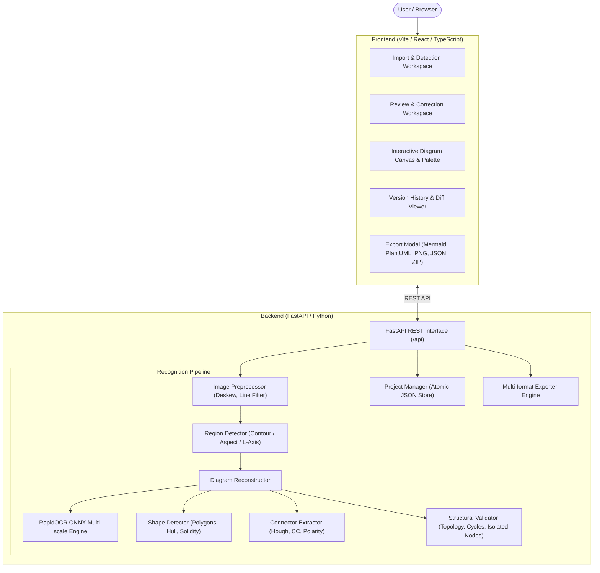

# ODR Architecture Specification

This document details the software architecture, design principles, subsystem responsibilities, and data models of the Optical Diagram Recognition (ODR) system.

## Table of Contents

- [Architectural Principles](#architectural-principles)
- [System Overview](#system-overview)
- [Pipeline Architecture](#pipeline-architecture)
  - [Image Ingestion and Preprocessing](#image-ingestion-and-preprocessing)
  - [Diagram Region Detection](#diagram-region-detection)
  - [Optical Character Recognition (OCR)](#optical-character-recognition-ocr)
  - [Geometric Shape Recognition](#geometric-shape-recognition)
  - [Connector Tracing and Topology Inference](#connector-tracing-and-topology-inference)
- [Canonical Data Model](#canonical-data-model)
- [Validation Engine](#validation-engine)
- [Export Architecture](#export-architecture)
- [Frontend Subsystem](#frontend-subsystem)
- [Persistence and Versioning](#persistence-and-versioning)

---

## Architectural Principles

ODR is built around the following technical tenets:

1. **Local-First Processing**: 100% of computer vision, OCR inference, geometric analysis, and exports execute locally on the host machine. No telemetry, user images, or diagram data are transmitted over the network.
2. **Structural Fidelity Over Cosmetic Smoothing**: Recognition prioritizes topology (exact nodes, directed edges, decision branch labels, and loop connections) rather than aesthetic approximations.
3. **Decoupled Canonical Representation**: The internal representation (`CanonicalDiagram`) serves as the single source of truth between the recognition engine, the visual editor, and multi-format exporters.
4. **Non-Destructive Editing & Review**: The user can review detected elements side-by-side against the original source crop with synchronized element highlighting, correct misclassifications, and restore previous snapshots.

---

## System Overview

---

## Pipeline Architecture

The recognition pipeline processes images sequentially through modular, independently verifiable stages.

### Image Ingestion and Preprocessing

- **File Support**: Raster images (`.png`, `.jpg`, `.jpeg`, `.bmp`, `.webp`) and multi-page documents (`.pdf` via PyMuPDF).
- **Deskewing**: Estimates global skew angle via `cv2.minAreaRect` on high-contrast edge contours and applies affine rotation if $|angle| > 0.5^\circ$.
- **Notebook Line Suppression**: Selectively suppresses faint blue/cyan notebook ruling lines while preserving dark navy, slate, and high-contrast technical strokes.

### Diagram Region Detection

- **Candidate Extraction**: Applies adaptive thresholding and morphological dilation to identify candidate diagram bounding boxes.
- **Hierarchical Classification**: Distinguishes nested diagrams within document pages or application screenshots. Automatically filters out outer window enclosing frames when distinct inner diagrams exist.
- **Type Heuristics**:
  - **Pie Charts**: Evaluates circularity ($>0.68$), convex hull solidity ($>0.88$), aspect ratio ($0.80 - 1.25$), and radial spoke line support.
  - **Bar Charts**: Identifies sets of vertical rectangles sharing aligned baselines, validated by coordinate axis intersection.
  - **Flowcharts**: The default diagram family when directed connections and process/decision blocks are identified.

### Optical Character Recognition (OCR)

- **Engine**: RapidOCR ONNX Runtime execution locally via CPU.
- **Adaptive Multi-scale Scaling**: Upscales low-resolution screenshot crops to a target dimension ($\approx 600\text{px}$, maximum factor $2.0\times$) using bicubic interpolation to maximize character contrast without stroke blooming.
- **Technical Vocabulary Normalization**: Applies regex normalization for common optical character confusions in technical workflows (`Bulb`, `Coffee machine`, `Refill tank`, `Refill grinder`, `Contact maintenance`, `No`, `Yes`).

### Geometric Shape Recognition

- **Polygon Approximation**: Uses `cv2.approxPolyDP` and convex hull analysis to determine shape geometry:
  - **Terminal / Start / End**: High aspect ratio with rounded corner curvature.
  - **Process**: 4 vertices with perpendicular corners.
  - **Decision**: 4 vertices rotated $\approx 45^\circ$ with equal diagonal bisectors.
  - **Input / Output (IO)**: Parallelograms with slanted side angles.
  - **Database / Data Store**: Cylindrical top/bottom curvature or open-ended horizontal bars.
- **Spatial Text Clustering**: Clusters vertically adjacent and horizontally overlapping text blocks, then assigns each cluster to the smallest enclosing shape contour.

### Connector Tracing and Topology Inference

- **Line Detection**: Combines continuous connected component morphology with `cv2.HoughLinesP` to detect both thick solid lines and dashed lines.
- **Intermediate Occlusion Check**: Evaluates whether a candidate connector jumps across an intermediate node along its span; bypass false positives are pruned.
- **Edge Deduplication and Polarity Resolution**: Groups parallel candidate fragments by node pair `(min(A, B), max(A, B))`. Resolves true flowchart flow direction (top-to-bottom hierarchy, decision-to-branch hierarchy, and role markers) while eliminating false reverse arrows.
- **Conditional Branch Binding**: Restricts conditional labels (`Yes`, `No`, `True`, `False`) exclusively to connectors originating from decision diamond elements. Automatically deduces complementary binary branches (e.g. `Yes` paired with unlabeled alternative deduced as `No`).

---

## Canonical Data Model

All internal state conforms to the `CanonicalDiagram` schema defined in `backend/core/models.py`:

| Entity | Attributes | Description |
|---|---|---|
| `CanonicalDiagram` | `id`, `project_id`, `name`, `family`, `subtype`, `elements`, `connectors`, `chart_data`, `version` | Root container for recognized or edited diagram state. |
| `DiagramElement` | `id`, `type`, `role`, `label`, `x`, `y`, `width`, `height`, `style`, `confidence`, `uncertainty_status` | Individual node (process, decision, terminal, database, etc.). |
| `DiagramConnector` | `id`, `source_id`, `target_id`, `source_handle`, `target_handle`, `label`, `direction`, `routing`, `waypoints` | Connection stroke between elements (directed, undirected, bidirectional). |
| `ChartData` | `chart_type`, `title`, `categories`, `series`, `is_estimated`, `confidence` | Structured tabular series data for bar and pie charts. |
| `ValidationIssue` | `id`, `severity`, `message`, `element_ids`, `connector_ids`, `suggested_fix` | Structural, topological, or label warning. |

---

## Validation Engine

The `DiagramValidator` (`backend/core/validator.py`) inspects diagrams for structural and semantic anomalies:

- **Isolated Nodes**: Elements with zero incoming and zero outgoing connectors.
- **Single-Branch Decisions**: Decision diamonds with fewer than two outgoing alternative branches.
- **Unlabeled Decision Branches**: Outgoing connectors from a decision that lack condition labels.
- **Dead-End Paths**: Non-terminal process elements with no exit path.
- **Confidence Outliers**: Elements or connectors flagged with recognition confidence below threshold ($<0.75$).

---

## Export Architecture

Exporters take a validated `CanonicalDiagram` and serialize it into target formats:

1. **Mermaid Exporter** (`backend/exporters/mermaid_exporter.py`):
   - Generates syntax for `flowchart TD`, `pie`, and `xychart-beta`.
   - Supports shape delimiters (`["..."]`, `{"..."}`, `(["..."])`, `[("...")]`, `{{ "..." }}`).
   - Automatically sanitizes labels against quote and bracket collision.
2. **PlantUML Exporter** (`backend/exporters/plantuml_exporter.py`):
   - Generates clean PlantUML syntax for activity and component diagrams.
3. **Canonical JSON Exporter** (`backend/exporters/json_exporter.py`):
   - Exports the complete schema with coordinate bounds, style properties, and provenance metadata.
4. **Raster PNG Exporter** (`backend/exporters/png_exporter.py`):
   - Generates antialiased, standalone PNG graphics via Pillow at custom resolution multipliers without browser UI dependencies.
5. **ZIP Bundle Exporter** (`backend/exporters/bundle_exporter.py`):
   - Assembles Mermaid (`.mmd`), PlantUML (`.puml`), JSON (`.json`), PNG (`.png`), and a machine-readable `manifest.json`.

---

## Frontend Subsystem

- **Runtime**: React 19, TypeScript, and Vite.
- **Canvas Subsystem**: Custom SVG rendering layer with responsive zoom/pan transforms, node dragging, interactive port handle connection, and live orthogonal Manhattan routing.
- **Review Subsystem**: Synchronized side-by-side comparison between source image crops and reconstructed elements.
- **State Management**: Reactive centralized state with undo/redo stack (`historyManager`) and debounced local storage persistence.

---

## Persistence and Versioning

- **Storage Location**: Local directory structure under `data/projects/{project_id}/`.
- **Atomic File Writes**: Prevents file corruption during unexpected termination by writing to temporary staging files before replacing project JSON.
- **Version History**: Checkpoints stored with timestamp, author, change description, and semantic element diff summaries.
